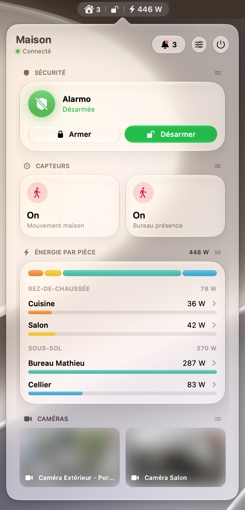

# HABar

A native macOS menu bar app for [Home Assistant](https://www.home-assistant.io). Fast, live, and built with SwiftUI and Liquid Glass.

<p align="center"></p>

- **Live**: one persistent WebSocket (`subscribe_entities`), no polling. The popover opens already up to date.
- **Sensors and toggles**: Control Center–style tiles. Tap a light, switch or fan to toggle it.
- **Cameras**: snapshot grid, click to enlarge. Refreshed every 2 s while open, every 60 s in the background, and the last frame is cached on disk so reopening is instant.
- **Alarm**: arm without a code, disarm with your PIN (asked only when HA requires one).
- **Energy by room**: live power per floor and room, from your HA Energy dashboard (same source and hierarchy as HA's power flow card).
- **Notifications and updates**: HA persistent notifications and available updates, with release notes and one-click install.
- **Menu bar**: pick what shows next to the icon, e.g. alarm lock state and total power.
- Drag and drop dashboard sections, light/dark/auto theme, French or English.

## Requirements

- macOS 26 or later
- Xcode 26 or later, to build (the Command Line Tools alone lack the SwiftUI macros)

## Install

With Homebrew (Apple Silicon):

```sh
brew tap mathieuletyrant/tap
brew trust --tap mathieuletyrant/tap   # Homebrew 7+ only loads third-party taps you trust
brew install --cask habar
```

Or in a `Brewfile`:

```ruby
tap "mathieuletyrant/tap"
cask "mathieuletyrant/tap/habar"
```

Updates: `brew update && brew upgrade --cask habar` (or a plain `brew upgrade`).

The app isn't notarized (no Apple Developer account), so the cask removes the quarantine flag during install.

From source:

```sh
git clone git@github.com:mathieuletyrant/habar.git
cd habar
./build.sh install   # builds, copies to /Applications and launches
```

`./build.sh` alone builds `build/HABar.app` without installing it.

To publish a new version, commit your changes then run `./build.sh release` (patch bump) or `./build.sh release 1.2.0`.
It tags and pushes; GitHub Actions runs the tests, publishes the release and updates the Homebrew cask, so users get it with `brew update && brew upgrade`.
The workflow needs a `TAP_TOKEN` secret: a fine-grained token with *Contents: read and write* on `homebrew-tap`.

## Setup

1. In Home Assistant, open your profile → **Security** → **Long-lived access tokens** → create one.
2. Click the house icon in the menu bar. Settings open on first launch.
3. Enter your server (e.g. `homeassistant.local:8123` or your Nabu Casa URL) and the token, then **Connect**.
4. **Add entities**, then use the ▦ / ▭ toggles on each one to show it on the dashboard and/or in the menu bar.

The token is stored in the macOS Keychain. Because the app is signed locally, macOS asks for Keychain access after each rebuild: choose **Always Allow**.

**Tip**: launching HABar from Spotlight or Raycast opens the popover.

## Configuration file

Settings live in `~/.config/habar/config.json` (pretty-printed, so you can keep it in your dotfiles; a symlink is preserved).
Every key is optional; a tile only needs an `entityId` (its kind is guessed from the domain):

```json
{
  "url": "homeassistant.local:8123",
  "language": "en",
  "tiles": [
    { "entityId": "alarm_control_panel.home", "inMenuBar": true },
    { "entityId": "sensor.house_power", "inMenuBar": true, "inDashboard": false },
    { "entityId": "camera.front_door" }
  ]
}
```

The token is never written there: it stays in the Keychain. The file is read at launch.

## Energy by room

HABar reads the individual devices of your HA **Energy dashboard** (with their power sensor) and groups them by area and floor. A device "included in" another only counts what its children don't.
If you show a whole-house power sensor as a tile, the gap between it and the rooms appears as **Other**.

Without Energy dashboard devices, HABar falls back to every power sensor.

## Project layout

```
Sources/Core/   HAClient (WebSocket, state, energy), models, Keychain, localization
Sources/Tiles/  one file per tile type: sensor, camera, alarm, energy
Sources/UI/     app and popover, dashboard, settings, entity picker, inbox, shared styles
tools/          make-icon.swift renders Resources/AppIcon.icns
```

To add a language, add its dictionary in `Sources/Core/Localization.swift`. `build.sh` warns about untranslated strings.
